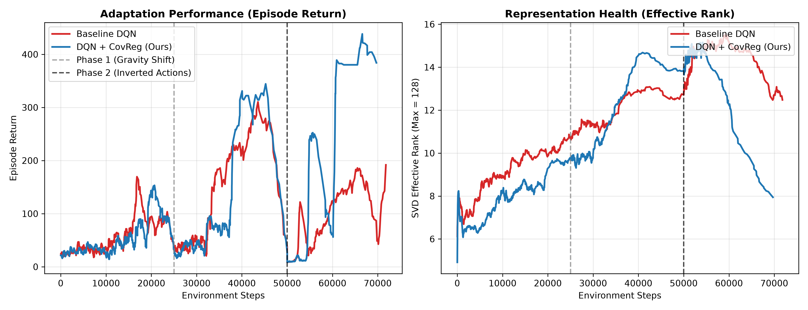

# Preserving Plasticity in Deep RL with Continuous Feature Decorrelation

PyTorch implementation and experiments exploring whether continuous feature decorrelation (`CovReg`) can prevent plasticity loss in deep RL without relying on discrete neuron resets.

## Motivation

Deep RL agents trained on non-stationary environments frequently lose the ability to learn over time ("loss of plasticity"). In value-based methods like DQN, bootstrapping on a moving target causes features in the penultimate layer to collapse into a low-dimensional subspace. In a network with 128 hidden units, the effective rank often falls below 15, leaving the network with very little capacity to adapt when environment dynamics change.

Recent mitigations like ReDo (Sokar et al., 2023), Continual Backpropagation (Dohare et al., 2024), and periodic layer resets (Nikishin et al., 2022) address this by identifying dead or low-utility units and reinitializing their weights. While effective, discrete resets cause sudden dips in policy performance and require resetting optimizer momentum buffers.

This repository tests a continuous alternative: adding an auxiliary penalty to the Bellman loss that directly penalizes pairwise correlation between hidden features.

## Method

During training, we compute the sample correlation matrix $C \in \mathbb{R}^{D \times D}$ of the penultimate activations across each mini-batch and add the mean squared off-diagonal correlation to the TD error:

$$\mathcal{L}_{\text{total}} = \mathcal{L}_{\text{TD}} + \lambda \cdot \frac{1}{D(D-1)} \sum_{i \ne j} C_{ij}^2$$

By pushing off-diagonal correlations toward zero, the network is continuously encouraged to keep its representations distributed across orthogonal directions.

## Experiment & Results

We compare baseline DQN against DQN + CovReg ($\lambda = 0.08$) on `NonStationaryCartPole` over 75,000 steps. The environment undergoes two scheduled shifts:
- **Step 25,000 (Physics shift):** Gravity increases from 9.8 to 24.5 m/s² and pole length is halved (0.5 to 0.25 m), requiring faster impulse corrections.
- **Step 50,000 (Semantic shift):** Controls are inverted (action 0 pushes right, action 1 pushes left).



| Step | Phase | Baseline DQN | DQN + CovReg | What happens |
| :---: | :--- | :---: | :---: | :--- |
| 10k | Default CartPole | 25.8 | 31.5 | Initial exploration |
| 20k | Default CartPole | 41.8 | 68.9 | CovReg learns faster early on |
| **25k** | **Shift 1: Heavy gravity** | — | — | Dynamics change |
| 30k | Adaptation | 37.3 | 33.2 | Both models dip as physics shift |
| 40k | Adaptation | 218.9 | 165.2 | Recovering balance |
| 50k | Adaptation | 239.0 | **356.9** | CovReg reaches 350+ reward before next shift |
| **50k** | **Shift 2: Inverted actions** | — | — | Actions swapped |
| 60k | Adaptation | 86.3 | 104.8 | Sharp drop due to 20k stale replay buffer transitions |
| 70k | Adaptation | 109.0 | **368.4** | CovReg recovers to 368+, baseline plateaus around 109 |

### Observations

When physics shift smoothly (step 25k), keeping feature representations decorrelated helps the agent discover the new balance policy more effectively (+49% return by step 50k). 

When actions invert completely (step 50k), both models drop hard because the replay buffer is still full of transitions from the previous mapping. But while baseline DQN struggles to adapt from stale data, DQN + CovReg recovers to over 360 reward.

One interesting nuance: even with the decorrelation loss active, the effective rank of features still hovers around 10–15 (out of 128). This highlights how strong the compression pressure from scalar Bellman bootstrapping really is.

## Quickstart

```bash
# Run tests
uv run pytest tests/

# Run the 75k step benchmark and generate results.png (~5 min on CPU)
uv run python benchmark.py
```
